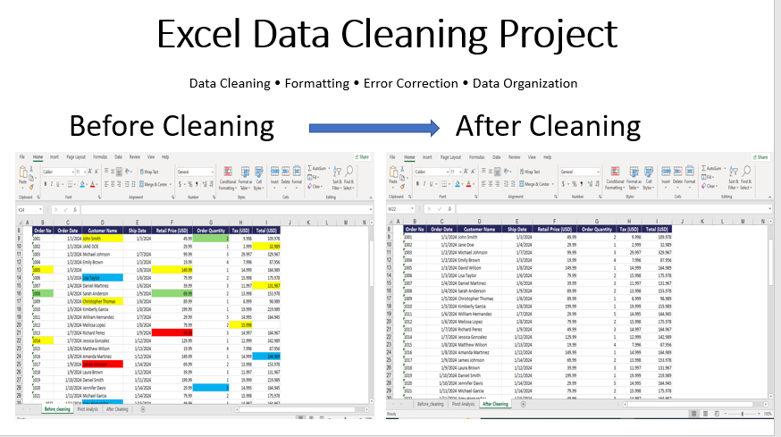

# Excel Data Cleaning Project

Cleaning and organizing a raw customer order dataset in Excel, with a before-and-after comparison.

## About
The workbook has three sheets: Before Cleaning (the raw data), Pivot Analysis, and After Cleaning (the final data).

## Columns in the dataset
Order No, Order Date, Customer Name, Ship Date, Retail Price (USD), Order Quantity, Tax (USD), Total (USD)

## What I did
- Marked problem cells in the raw data using color highlights
- Corrected errors and made the formatting consistent across names, dates, and numbers
- Organized the data into a clean table with formatted headers
- Built a pivot analysis from the cleaned data

## Tools used
Microsoft Excel (data cleaning, formatting, error correction, pivot tables)
